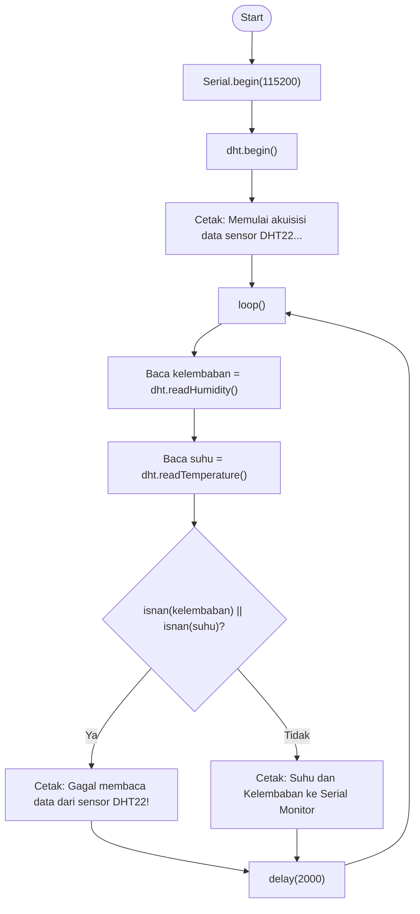

# Jawaban Pertanyaan Percobaan 1A

## Soal 1: Gambarkan diagram alur (flowchart) proses akuisisi data sensor DHT22 pada program di atas

**Jawaban:**
Alurnya dimulai dari inisialisasi (`Serial.begin()` dan `dht.begin()`), lalu masuk ke `loop()` yang berjalan berulang: sensor membaca suhu dan kelembaban (`readTemperature()`, `readHumidity()`), kemudian program memeriksa apakah hasilnya valid menggunakan `isnan()`. Jika hasilnya `NaN`, program mencetak pesan "gagal membaca"; jika valid, program mencetak nilai suhu dan kelembaban ke Serial Monitor. Setelah itu program menunggu (`delay(2000)`) sebelum kembali ke langkah pembacaan berikutnya, membentuk siklus berulang tanpa akhir.

## Soal 2: Apa fungsi dari perintah isnan() pada program tersebut?

**Jawaban:**
`isnan()` memeriksa apakah nilai yang dikembalikan sensor adalah angka yang valid atau "Not a Number" (`NaN`). DHT22 mengembalikan `NaN` saat pembacaan gagal, misalnya karena koneksi kabel longgar, gangguan timing komunikasi, atau sensor belum siap. Dengan pengecekan ini, program bisa membedakan data valid dari data gagal dan menampilkan peringatan yang sesuai, bukan angka yang keliru.

## Soal 3: Jelaskan mengapa diperlukan jeda (delay) minimal sekitar 2 detik antar pembacaan sensor DHT22

**Jawaban:**
DHT22 memiliki siklus sampling internal sekitar 2 detik karena elemen sensornya butuh waktu untuk stabil dan mengirim data melalui protokol komunikasi satu jalur (single-wire) yang relatif lambat. Jika dibaca lebih cepat dari itu, sensor belum sempat menyiapkan data baru sehingga hasil pembacaan bisa tidak akurat atau justru menghasilkan `NaN`.

## Soal 4: Modifikasi program agar data suhu dan kelembaban dirata-ratakan dari 5 kali pembacaan sebelum ditampilkan, dan berikan penjelasan di setiap baris kode yang ditambahkan dalam bentuk README.md

**Jawaban:**
Programnya diubah agar ada perulangan 5 kali pembacaan yang nilainya diakumulasikan ke variabel total, hanya menghitung sampel yang valid (bukan `NaN`), lalu dibagi jumlah sampel valid untuk mendapat rata-rata sebelum ditampilkan.

[Perubahan Kode Percobaan 1](Percobaan1AMod.ino)
