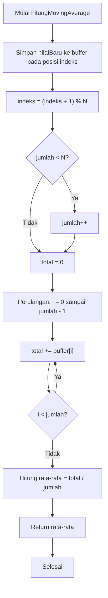

# Jawaban Pertanyaan Percobaan 5A

## Soal 1: Gambarkan diagram alur (flowchart) proses perhitungan moving average pada fungsi hitungMovingAverage()!

**Jawaban:**

## Soal 2: Jelaskan fungsi dari operasi (indeks + 1) % N pada program tersebut!

**Jawaban:**
Operasi `(indeks + 1) % N` berfungsi sebagai **circular index** (indeks melingkar). Setelah menyimpan data baru ke posisi `indeks`, posisi ditambah 1 lalu diambil sisa bagi terhadap `N`. Contohnya jika `N = 5`, maka indeks akan bergerak dari 0, 1, 2, 3, 4, lalu kembali ke 0, dan seterusnya. Ini memungkinkan buffer digunakan secara berputar (*ring buffer*) tanpa perlu menggeser elemen array, sehingga data lama otomatis tertimpa oleh data baru ketika buffer sudah penuh.

## Soal 3: Apa dampaknya terhadap data hasil filter apabila nilai N diperbesar menjadi 20 atau diperkecil menjadi 2?

**Jawaban:**
- **N diperbesar menjadi 20**: Data hasil filter akan menjadi **lebih halus** karena rata-rata dihitung dari 20 sampel terakhir, sehingga fluktuasi acak dan *noise* lebih teredam. Namun, **responsnya menjadi lebih lambat** terhadap perubahan suhu yang sesungguhnya karena nilai rata-rata membutuhkan lebih banyak sampel baru untuk bergeser.
- **N diperkecil menjadi 2**: Data hasil filter akan **lebih responsif** terhadap perubahan suhu karena hanya 2 sampel terakhir yang dirata-ratakan. Namun, **efek penghalusan sangat minim** sehingga *noise* dan gangguan pembacaan tetap terlihat pada data hasil filter.

## Soal 4: Modifikasi program agar ESP32 juga menghitung simpangan baku dari data pada buffer, dan berikan penjelasan di setiap baris kode yang ditambahkan dalam bentuk README.md.

**Jawaban:**
Penjelasan perubahan kode:
- Ditambahkan `#include <math.h>` untuk mengakses fungsi `sqrt()` yang digunakan menghitung akar kuadrat.
- Dibuat fungsi baru `hitungSimpanganBaku()` yang menghitung simpangan baku (*standard deviation*) dari data yang ada pada buffer:
  - Jika jumlah data kurang dari 2, langsung mengembalikan 0.0 karena simpangan baku tidak dapat dihitung.
  - Menghitung rata-rata seluruh data di buffer terlebih dahulu.
  - Menghitung total kuadrat selisih setiap data terhadap rata-rata.
  - Membagi total kuadrat dengan `(jumlah - 1)` sebagai *sample variance* (menggunakan rumus Bessel's correction).
  - Mengembalikan akar kuadrat dari varians sebagai nilai simpangan baku.
- Pada `loop()`, ditambahkan pemanggilan `hitungSimpanganBaku()` dan hasilnya dicetak ke Serial Monitor dengan label `StdDev`.

[Perubahan Kode Percobaan 5A](Percobaan5AMod.ino)
